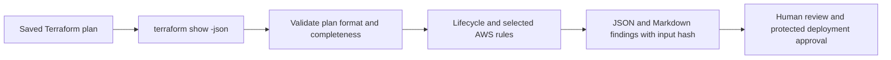

# Terraform AWS Change Review

[](https://github.com/dhanraj002/terraform-aws-change-review/actions/workflows/ci.yml)

Review a saved Terraform plan before approving infrastructure changes. This small Python CLI flags deletions, replacements, public administrative ingress and selected storage protections. It also tells you when an attribute is unknown or a resource type is outside its coverage.

The problem: a successful `terraform plan` means Terraform produced a plan. It does not mean deleting a database, replacing a volume or opening SSH to the world is an acceptable change.

## Try it in two minutes

Python 3.11+; standard library only. Run from the repository root:

```bash
python3 review.py examples/safe.json --output reports/safe
# Exit 0: no findings under the selected rules.
python3 review.py examples/risky.json --output reports/risky
# Exit 1 is expected: replacement, disabled encryption and public SSH.
python3 review.py examples/unknown.json --output reports/unknown
# Exit 1: encryption cannot be determined before apply.
python3 -m unittest discover -s tests -v
```

Open `reports/risky/report.md` or `report.json`. The example AWS plans are synthetic; [sample output](examples/sample-report.md) is available without running the tool.

## What gets reviewed

| Scope | Rule |
| --- | --- |
| All changed managed resource types | Delete, replace (either ordering), and forget/remove-from-state actions |
| `aws_ebs_volume` | Explicit encryption setting |
| `aws_db_instance` | Storage encryption and deletion protection |
| `aws_vpc_security_group_ingress_rule` | IPv4/IPv6 `/0` ingress containing TCP 22/3389 or all protocols |
| Supported security attributes | Missing or unknown values require review |
| Other changed resource types | `UNASSESSED_TYPE`; lifecycle review only, never silent attribute approval |

Unchanged resources and data sources are outside scope. Inline `aws_security_group` rules, legacy `aws_security_group_rule`, IAM, KMS, network reachability, costs and application downtime are not assessed. Split CIDRs that collectively cover the internet are not detected. Public ingress does not by itself establish internet reachability.



## Use with your own plan

Generate the plan in your existing Terraform workspace using its normal credentials and backend. The reviewer itself has no AWS dependencies and performs no API calls:

```bash
umask 077
mkdir -p reports
terraform plan -out=reports/change.tfplan
terraform show -json reports/change.tfplan > reports/change.json
python3 /path/to/terraform-aws-change-review/review.py \
  reports/change.json --output reports/change-review
```

| Exit | Meaning |
| --- | --- |
| `0` | No findings within this tool's limited scope; not permission to apply |
| `1` | Manual review required, including unknown/unsupported coverage |
| `2` | Incomplete/deferred/errored plan, invalid input or I/O failure |

Treat all nonzero exits as a stopped gate. Do not use `continue-on-error` to turn a failed review green. On invalid input, no new report is produced; never consume an old report without checking the current exit code and input SHA256. Reports are evidence, not authenticated approvals. Protect the reviewer version, policy changes and deployment workflow from untrusted pull requests. Apply the same saved binary plan through your approved process; a JSON hash alone does not prove binary-plan provenance.

Terraform JSON can contain secrets even when marked sensitive. Keep the raw plan and generated reports in restricted storage; do not upload them to public Actions artifacts or PR comments. Reports omit resource attribute values and Terraform outputs, but resource addresses may still contain identifying names or keys. The output files use mode 0600 on POSIX systems. Use a private output directory; filesystem permission settings are not a sandbox against other processes running as you.

## Reproduce a real Terraform parser check

The built-in `terraform_data` example requires Terraform 1.4+ and no AWS provider or account:

```bash
mkdir -p reports
terraform -chdir=examples/native-plan init -backend=false
terraform -chdir=examples/native-plan plan -out=local.tfplan
terraform -chdir=examples/native-plan show -json local.tfplan > reports/native.json
python3 review.py reports/native.json --output reports/native
# Exit 1: terraform_data has no AWS attribute checks and is explicitly unassessed.
```

No `apply` is needed. Remove the local plan and `.terraform` directory when finished. This check validates real Terraform plan ingestion, not AWS deployment.

## Operations and design

- Start with one reviewed plan and inspect the coverage list alongside the findings.
- Resolve a finding by correcting the infrastructure configuration and regenerating the plan, or use your organization's independently approved exception process. There is intentionally no blanket skip flag.
- Treat replacement as a recovery discussion: dependencies, stateful data, backups and rollback matter even when `create_before_destroy` is enabled.
- Unknown security settings must be resolved or reviewed; they are not assumed safe.
- Restrict this tool to trusted generated plans. It validates relevant fields, not the complete Terraform schema. Input is limited to 50 MiB.
- The included CI runs offline fixtures and unit tests without cloud secrets. It never deploys infrastructure.

The Python rules are intentionally inspectable. Larger estates should evaluate established policy engines and broader security scanners rather than expanding a small custom tool indefinitely.

## Portfolio context

This complements [AWS Terraform Cloud Platform](https://github.com/dhanraj002/aws-terraform-cloud-platform), [AWS Governance Auditor](https://github.com/dhanraj002/aws-governance-auditor) and [PHP SSM Patch Review](https://github.com/dhanraj002/aws-ssm-php-patch-review): review proposed changes, deliver a workload, inspect deployed infrastructure, and remediate a specific runtime issue.

Validation: 21 unit/CLI tests passed locally on 30 October 2026. The native Terraform plan was also parsed and correctly reported as an unassessed resource type. Coverage includes synthetic AWS plan fixtures and a local built-in-provider Terraform plan. No live AWS resources were created for this project and no production adoption or compliance certification is claimed.

Format reference: [HashiCorp Terraform JSON output](https://developer.hashicorp.com/terraform/internals/json-format). Supports format major version 1 and ignores additional fields for compatible minor versions; unknown action sequences fail rather than being guessed.
